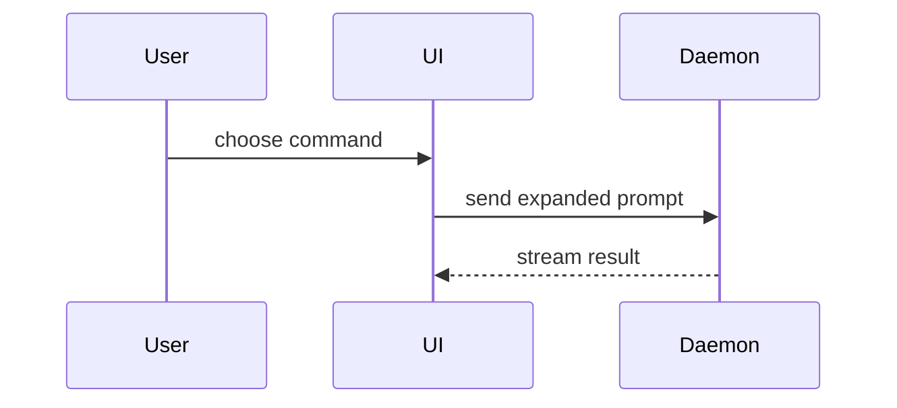

---
metadata:
  credits:
    skill: show-me
    author: Dex Horthy
    organisation: Humanlayer
    url: "https://github.com/humanlayer/skills/blob/main/plugins/show-me/skills/show-me/SKILL.md"
---

<template>
A pull request body has three parts in this order. They are the summary, the evidence, and the merge danger. This template shows each part as plain paragraphs.

```markdown
<short text the visual supports>

<diagram, diff sketch, or tree>

Before the change, <screenshot, output, or failing test run>. After it, <screenshot, output, or passing test run>.

This is a <one-way or two-way> door. <optional description>

The blast radius is <one-word description>. <optional potential ramifications of the merge>
```
</template>

<sections>
Skip all preambles and keep prose brief. Use the user's domain language from `GLOSSARY.md`.

<summary>
Pick the smallest view that makes the key point clear.

Show logic or an algorithm as pseudocode.

```text
on(save)
  if content is unchanged
    return cached result
  write new content
  return fresh result
```

Show runtime control flow as a call tree.

```text
submitForm
  createSession
    persistPrompt
    launchAgent
  navigateToSession
```

Show UI structure as a component tree. Include the state and module boundaries that matter.

```text
<SessionPage> (apps/example/src/routes/session.tsx)
  useSessionEvents()
  <SessionToolbar>
    <RunSkillButton> (packages/ui)
```

Show file responsibility or a broad refactor as a shallow file tree.

```text
src/
├── commands/       # parses user actions
├── sessions/       # owns session state
└── transport/      # sends API requests
```

Show component interaction, control flow, or data flow with Mermaid.



Use `diff` when the point is what changes and the surrounding shape already exists. Match the diff shape to the topic. This diff shows a component change.

```diff
 <SessionPage>
   useSessionEvents()
   <SessionToolbar>
+    <RunSkillButton />
   <SessionTimeline>
+    <SkillResultCard />
```

This diff shows a file-layout change.

```diff
 src/
 ├── commands/
+│   └── show-me.ts       # expands the slash command
 ├── sessions/
-└── transport.ts
+└── transport/
+    ├── client.ts
+    └── stream.ts
```

This diff shows a call-tree or call-stack change.

```diff
 submitForm
   createSession
     persistPrompt
+    expandSkillMention
     launchAgent
-  navigateToSession
+  navigateToSession
+    subscribeToEvents
```

This diff shows a state or control-flow change.

```diff
 on(save)
-  write content
+  if content is unchanged
+    return cached result
+  write new content
+  invalidate cache
```

Show the whole block when most of it is new, or when omitted context would hide ownership or order. Also show it when the user needs a copyable target shape, as with this function.

```ts
function expandSkill(command: string): string {
  const skillName = command.slice(1);
  return `use the ${skillName} skill`;
}
```

Place each visual next to the short text it supports. Keep only the calls, files, props, states, and boundaries the current question needs. The same holds for the options that resolve the current discussion point. Use one view or several, and rarely all of them. Use your judgement, and do not overwhelm the reader.
</summary>

<evidence>
The evidence is concrete proof that the change works, shown as a before and an after. Screenshots are S-tier evidence when the environment supports them and the change is visual. Execution-based evidence, such as test results and console output, is A-tier. Show the exact test that now fails and then passes, in pseudocode.
</evidence>

<merge_danger>
State whether the change is a one-way or a two-way door. You can walk back through a two-way door, but not through a one-way door. A PR that is cheap to roll back carries lower risk. Changes with destructive actions or hard-to-reverse decisions are one-way doors.

The blast radius is the potential impact or scope of the changes in this PR. Consider all possibilities, such as layout shift, breakage for consumers, and mobile responsiveness.
</merge_danger>
</sections>
