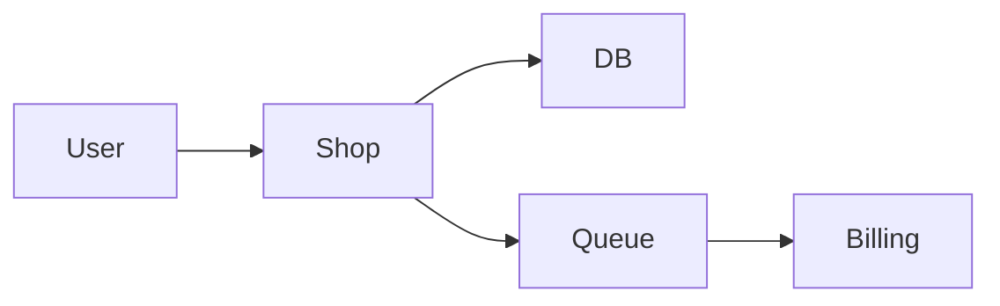
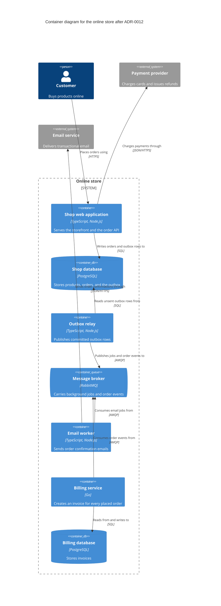

# Architecture decision examples

These examples are illustrative. Copy the reasoning, not the exact shape.

## Contents

- A minimal ADR for a new decision
- Superseding an accepted ADR
- A C4 container diagram in text

## A minimal ADR for a new decision

The shop is one TypeScript service with one PostgreSQL database. Checkout sends the confirmation email and renders the invoice inside the HTTP request, and the user approved a plan that moves this work to background jobs in a table of the existing database.

Before, in `docs/decisions/0007-queue.md`

```markdown
# Queue

We will use Postgres for the queue because it is simpler and scalable.
```

After, in `docs/decisions/0007-use-postgresql-table-for-background-jobs.md`

```markdown
---
status: "accepted"
date: 2026-03-04
---

# Use a PostgreSQL table for background jobs

## Context and Problem Statement

Checkout sends the order confirmation email and renders the invoice PDF inside the HTTP request, so a slow email provider makes checkout slow and a provider outage fails the order. The shop runs as one service with one PostgreSQL database and is operated by a team of three. Where should work that can happen after the response be queued and run?

## Decision Drivers

* Functional suitability, functional correctness. A job exists only when its order has committed.
* Reliability, recoverability. A queued job survives a crash or a deploy and runs afterwards.
* Maintainability. The team runs no infrastructure beyond the service and its database.
* Performance efficiency, capacity. The queue handles the current peak of about 20,000 jobs a day, an estimate from last quarter's order volume.

## Considered Options

* Job table in the existing PostgreSQL database, claimed with `FOR UPDATE SKIP LOCKED`
* Redis with a job queue library
* RabbitMQ

## Decision Outcome

Chosen option: "Job table in the existing PostgreSQL database", because it is the only option that writes the job in the same transaction as the order, and it adds no infrastructure to run.

### Consequences

* Good, because a job exists if and only if its order committed.
* Good, because the existing database backups and monitoring cover the jobs.
* Bad, because polling workers add load to the database that serves checkout.
* Bad, because another service could only consume these jobs by reading this service's tables.

### Confirmation

An integration test rolls back an order and asserts that no job row exists, and code review rejects any job that is enqueued outside the order transaction.
```

The first record names neither the problem nor the alternatives, so a later reader cannot tell whether its reasons still hold. The second states the problem as a question, phrases the drivers as ISO/IEC 25010 characteristics, marks the estimate, and lists the costs the team accepted. Its status is `accepted` because the user approved the plan that contained the decision.

## Superseding an accepted ADR

Invoicing later moved to a separate billing service written in Go, which has to react to every placed order. The user agreed to replace the job table with a message broker, so a new record supersedes ADR-0007 and the old record keeps its text.

New record, `docs/decisions/0012-use-rabbitmq-for-background-jobs-and-order-events.md`

```markdown
---
status: "accepted"
date: 2026-09-21
---

# Use RabbitMQ for background jobs and order events

## Context and Problem Statement

Invoicing moved from the shop to a separate billing service written in Go, which must create an invoice for every placed order. ADR-0007 keeps jobs in a table of the shop database, so the billing service would have to read the shop's tables to find its work. How should background jobs and order events reach the email worker and the billing service?

## Decision Drivers

* Maintainability, modularity. No service reads another service's tables.
* Compatibility, interoperability. Producers and consumers are written in TypeScript and Go.
* Functional suitability, functional correctness. An event is published only for an order that committed.

## Considered Options

* RabbitMQ, with a transactional outbox table in the shop database
* Billing service reads the shop's job table
* Shop calls the billing service over HTTP after the order commits

## Decision Outcome

Chosen option: "RabbitMQ, with a transactional outbox table in the shop database", because it keeps every service's tables private and still publishes an event only for a committed order.

### Consequences

* Good, because a new consumer subscribes to order events without a change to the shop.
* Bad, because the team now operates and monitors a RabbitMQ cluster.
* Bad, because a consumer can receive the same event twice, so every consumer must be idempotent.

### Confirmation

A contract test in the billing service consumes a recorded `order.placed` event, and an architecture test fails when billing code references the shop database.

## More Information

Supersedes [ADR-0007](0007-use-postgresql-table-for-background-jobs.md).
```

Before, the front matter of ADR-0007

```markdown
---
status: "accepted"
date: 2026-03-04
---
```

After, the front matter of ADR-0007

```markdown
---
status: "superseded by ADR-0012"
date: 2026-09-21
---
```

Added at the end of ADR-0007

```markdown
## More Information

Superseded by [ADR-0012](0012-use-rabbitmq-for-background-jobs-and-order-events.md).
```

The old context, options, outcome, and consequences stay word for word, so the history shows what was decided in March and why. Both files change in the same commit, and the links point both ways.

## A C4 container diagram in text

Before



After



Key. Each box shows its type and technology in brackets, grey boxes are systems outside the online store, upright cylinders are databases, the horizontal cylinder is a queue, and each arrow points from the element that starts the interaction.

The flowchart has no element types, technologies, or protocols, and its unlabelled arrows do not say who calls whom. The C4 version is a container diagram of one software system, with a title, typed and described elements, a technology on every container, and a specific label and protocol on every line. It lives as text next to the ADRs, so it changes in the same commit as the decision it shows.
