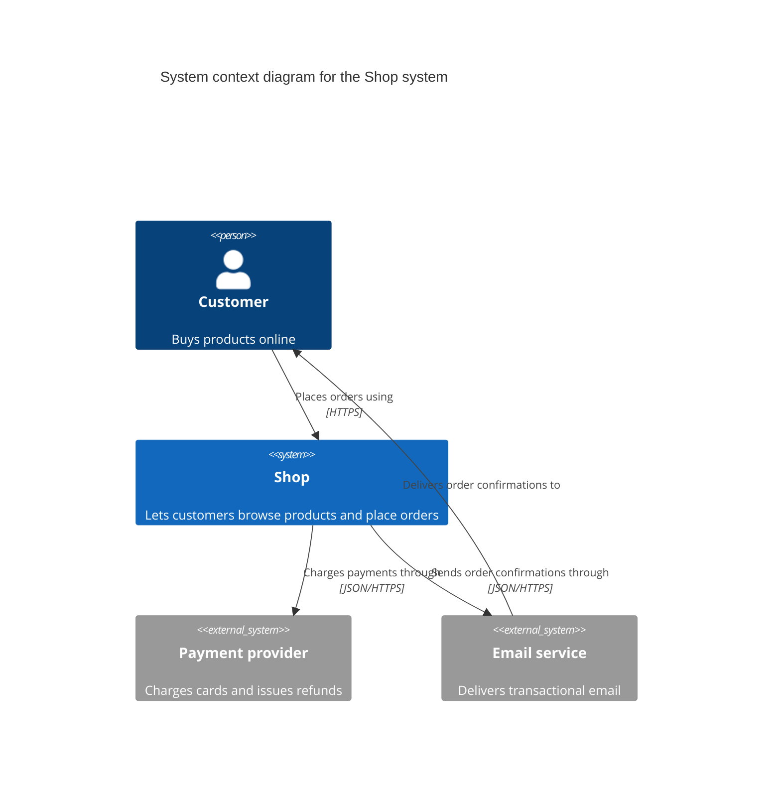

# C4 model

The C4 model by Simon Brown describes a software system at four levels of zoom. It is independent of notation and tooling, so the same model can be written in Mermaid, Structurizr DSL, or another tool. The model's own guidance is that not every level is needed, only those that add value, and that the system context and container diagrams are sufficient for most teams.

## Contents

- Levels
- Supplementary diagrams
- Notation rules
- Mermaid C4
- Structurizr DSL

## Levels

| Diagram | Scope | Shows | Audience | Recommended |
|---|---|---|---|---|
| System context | One software system | The system, plus the people and external systems directly connected to it | Everybody, technical and non-technical | Yes, for every team |
| Container | One software system | The containers inside the system, plus the people and systems connected to them | Technical people inside and outside the team | Yes, for every team |
| Component | One container | The components inside the container, plus the containers, people, and systems connected to them | Architects and developers | Only when it adds value, and automated for long-lived documentation |
| Code | One component | Classes, interfaces, functions, or tables inside the component | Architects and developers | No, because IDEs generate this level on demand |

A container is a runtime boundary around code that runs or data that is stored, such as a server-side web application, a single-page application, a mobile app, a serverless function, a database, a blob store, or a file system. It has nothing to do with Docker containers.

## Supplementary diagrams

- **System landscape** shows the software systems and people across an organization.
- **Dynamic** shows how elements collaborate at runtime for one scenario.
- **Deployment** maps containers onto infrastructure for one environment. Clustering, load balancers, replication, and failover belong here, not on the container diagram.

## Notation rules

- Every diagram has a title that names its type and scope.
- Every diagram has a key or legend that makes the notation explicit, and the notation itself is as self-describing as possible.
- Acronyms and abbreviations are understandable by every audience or explained in the key.
- Every element has an explicit type and a short description of its responsibility.
- Every container and component has an explicit technology.
- Every line is one relationship in one direction, with a specific label that matches the direction. Avoid single words like "Uses".
- Lines between containers carry the technology or protocol, such as `JSON/HTTPS` or `AMQP`.
- Colours are free to choose but consistent within and across diagrams.

## Mermaid C4

The Mermaid documentation marks C4 as experimental and says the syntax can change, so use only the elements below and check that the diagram renders. GitHub renders fenced code blocks with the `mermaid` language identifier in Markdown files.

- Mermaid C4 draws no legend, because its documentation lists Legend among the unsupported features. Write a one-line key under every diagram that explains the shapes and colours.
- Layout is not fully automatic. Shapes are placed in the order the statements are written, so reorder the statements when lines cross or labels overlap, and look at the rendered result.
- Use `Rel` for every line. `BiRel` draws a two-way line, which the C4 notation rules discourage.

| Element | Parameters |
|---|---|
| Diagram types | `C4Context`, `C4Container`, `C4Component`, `C4Dynamic`, `C4Deployment` |
| `title` | Free text on one line after the diagram type |
| `Person`, `Person_Ext` | `alias, label, ?descr` |
| `System`, `System_Ext`, `SystemDb`, `SystemQueue` | `alias, label, ?descr` |
| `Container`, `Container_Ext`, `ContainerDb`, `ContainerQueue` | `alias, label, ?techn, ?descr` |
| `System_Boundary`, `Container_Boundary` | `alias, label`, followed by a block in braces |
| `Rel` | `from, to, label, ?techn` |

A system context diagram.



Key. Each box shows its type in brackets, grey boxes are systems outside the Shop, and each arrow points from the element that starts the interaction.

## Structurizr DSL

Structurizr DSL describes the model once and derives each view from it. The syntax for the elements used here is `person <name> [description] [tags]`, `softwareSystem <name> [description] [tags]`, `container <name> [description] [technology] [tags]`, and `<identifier> -> <identifier> [description] [technology] [tags]`. A view is `systemContext <system>` or `container <system>` with `include *` and an optional `autoLayout` direction of `tb`, `bt`, `lr`, or `rl`.

A system context view and a container view of the same model.

```
workspace {

    model {
        customer = person "Customer" "Buys products online"
        payments = softwareSystem "Payment provider" "Charges cards and issues refunds"
        shop = softwareSystem "Shop" "Lets customers browse products and place orders" {
            webapp = container "Web application" "Serves the storefront and the order API" "TypeScript, Node.js"
            database = container "Database" "Stores products, customers, and orders" "PostgreSQL"
        }

        customer -> webapp "Places orders using" "HTTPS"
        webapp -> database "Reads from and writes to" "SQL"
        webapp -> payments "Charges payments through" "JSON/HTTPS"
    }

    views {
        systemContext shop {
            include *
            autoLayout lr
        }

        container shop {
            include *
            autoLayout lr
        }
    }

}
```
